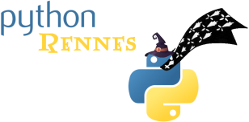

:revealjs_customtheme: assets/beige-stylesheet.css
:revealjs_progress: true
:revealjs_slideNumber: true
:source-highlighter: highlightjs
:icons: font
:toc:

= Python Rennes - mercredi 1er juillet 2026

== Parlons SQL et ORM

[.medium-text]
--
- Plaidoyer pour un monde sans ORM (**Jonathan Léger**)
- SQL avancé (via ORM Django) (**Anthony Ricaud**)
--

[.small-text]
--
Python Rennes - mercredi 1er juillet 2026 - **Liksi** 🙏
--

== Prochainement dans http://rennes.tech

* BreizhCamp 2026 🌡️ (24-26 juin)

* les vacances 🏖️⛰️

* WordCamp Bretagne 2026 : vendredi 18 septembre, Couvent des Jacobins https://bretagne.wordcamp.org/2026/[bretagne.wordcamp.org/2026]

[.columns]
== La communauté Python Rennes

[.column]
--
[.medium-text]
Communauté "services numériques" complétant les communautés datascience existantes.

[.medium-text]
643 membres

.Groupe meetup : https://www.meetup.com/fr-FR/python-rennes/

--

[.column]
--
[.medium-text]
Rejoignez https://pythonrennes.slack.com[pythonrennes.slack.com] (actualités, entraide, orga).

[.medium-text]
114 membres

.Invitation slack : https://join.slack.com/t/pythonrennes/shared_invite/zt-1yd4yioap-lBAngm3Q0jxAKLP6fYJR8w
image::assets/qr_code-slack-Python_Rennes.svg[Rejoindre le slack Python Rennes, 50%]
--

[.column]
--
[.medium-text]
* Mastodon : https://social.breizhcamp.org/@pythonrennes[@pythonrennes@social.breizhcamp.org] · 78 membres
* BlueSky : https://bsky.app/profile/pythonrennes.bsky.social/[@pythonrennes.bsky.social] · 59 membres
* LinkedIn : https://www.linkedin.com/groups/13121746/[www.linkedin.com/groups/13121746] · 55 membres
--

== Quoi de n'œuf ?

=== Écosystème Python - les confs

EuroPython 2026 (13-19 juillet), Cracovie 🇵🇱,  https://ep2026.europython.eu/[ep2026.europython.eu]

* EuroSciPy 2026 (18-23 juillet)
* Rust Summit (13 juillet)

PyConFR 2026 (29 oct-1er nov), Biarritz 🏖️, https://www.pycon.fr/2026/[www.pycon.fr/2026/]

* https://cfp.pycon.fr/pyconfr-2026/cfp jusqu'à fin juillet ⚠️

=== Écosystème Python - du PEPs

pip 26.1 : gestion expérimentale des lockfiles (PEP 751) https://ichard26.github.io/blog/2026/04/whats-new-in-pip-26.1/[ichard26.github.io/blog/2026/04/whats-new-in-pip-26.1]

Le comité de pilotage de la PSF demande au groupe de travail du compilateur JIT de spécifier sa feuille de route autour d'une PEP claire : https://discuss.python.org/t/an-announcement-from-the-steering-council-regarding-the-jit-project/107638[discuss.python.org/t/an-announcement-from-the-steering-council-regarding-the-jit-project]

PEP 783 : possibilité de publier sur PyPI des paquets construits pour PyOdide (webassembly) https://blog.pyodide.org/posts/314-release/[blog.pyodide.org/posts/314-release]

* 📽️ rediff' https://www.youtube.com/watch?v=Dzjjwhx2Amk&list=PLv7xGPH0RMUT1GSCGHJmqnswpk-nyz5aq&index=3&t=1129[Python loin de ton ordinateur]

=== Services et outils

* interception & mémorisation des IO non-déterministes (réseau, bdd, fichiers) ; rejouable en mode debug : https://retracesoftware.com/blog/introducing-retrace/[retracesoftware.com/blog/introducing-retrace]

* équivalences de commandes entre `uv` et `pdm` : https://stuartm.nz/2026/04/pdm-rocks/[stuartm.nz/2026/04/pdm-rocks]

* pipx 1.12.0 peut utiliser `uv` sous le capot (pipx ≈ uv tool)
https://pipx.pypa.io/stable/explanation/comparisons/#pipx-vs-uv-tool[pipx.pypa.io/stable/explanation/comparisons/#pipx-vs-uv-tool]

=== Bibliothèques

* barre de progression pour CLI
** https://tqdm.github.io/[tqdm.github.io]
** https://github.com/rsalmei/alive-progress[github.com/rsalmei/alive-progress]

* comparaison des fonctionnalités et des performances de différents ORM : https://medium.com/@inprogrammer/i-tested-5-python-orms-one-replaced-sqlalchemy-completely-e423699a1ac8?sk=e87b360934f7ab1529b2901edffc1aa8[medium.com/@inprogrammer/i-tested-5-python-orms-one-replaced-sqlalchemy-completely-...]

* chargement de la configuration d'un projet django à partir de fichiers .toml https://github.com/adamghill/dj-toml-settings[github.com/adamghill/dj-toml-settings]

=== Code & architecture

Extensions codium / vsCode pour commuter de `.venv` en monorepo Python

* `teticio.python-envy`
* `ms-python.vscode-python-envs`

"Don't use booleans, use policies" (ArjanCodes) https://youtu.be/wYeDGkdMi3g[youtu.be/wYeDGkdMi3g]. Remplacement de if par des protocoles, des instances ou des fonctions

* 📽️ rediff' https://www.youtube.com/watch?v=qAS-zj0irEM&list=PLv7xGPH0RMUT1GSCGHJmqnswpk-nyz5aq&index=12&t=680[Annotations de typage]

=== Code & architecture - 2

* monkeypatching et création de mocks pour des tests :
** Bob Benderbos : https://belderbos.dev/blog/python-mock-patch-verify-interception/[belderbos.dev/blog/python-mock-patch-verify-interception]
** "Monkeypatching!" (Anthony Sottile) : https://youtu.be/ZW0QaclnJKA[youtu.be/ZW0QaclnJKA]

* critiques sur la gestion des limites de version des dépendances gérées avec uv : https://www.loopwerk.io/articles/2026/uv-ux-mess/[www.loopwerk.io/articles/2026/uv-ux-mess]

* "Rust for Python Programmers: Complete Training Guide" : https://microsoft.github.io/RustTraining/python-book/[microsoft.github.io/RustTraining/python-book]

=== Code & architecture - 3

* limites de l'approche conventional commits : https://sumnerevans.com/posts/software-engineering/stop-using-conventional-commits/[sumnerevans.com/posts/software-engineering/stop-using-conventional-commits]
** 📽️ rediff' https://youtu.be/KKBBOGeRPJg?si=K8BkwkA6WAJb7JmS[Optimiser son intégration continue de projet Python (mais pas que)]
** template alternatif de message de commit : https://codeinthehole.com/tips/a-useful-template-for-commit-messages/[codeinthehole.com/tips/a-useful-template-for-commit-messages]
** https://towncrier.readthedocs.io/en/stable/ : une CLI pour manipuler les changelogs

=== Infrastructure

slimtoolkit : réduit la taille d'une image docker en ne conservant que les fichiers mobilisés par un traçage d'exécution

* https://codecut.ai/shrink-python-container-slimtoolkit/[codecut.ai/shrink-python-container-slimtoolkit]
* https://github.com/slimtoolkit/slim[github.com/slimtoolkit/slim]

=== Cybersécurité

* "GitHub Actions is the weakest link" (Andrew Nessbit) (@andrewnez@mastodon.social). Attaque de supplychain par mauvaises pratiques des GitHubActions : https://nesbitt.io/2026/04/28/github-actions-is-the-weakest-link.html[nesbitt.io/2026/04/28/github-actions-is-the-weakest-link.html]
** trusted publishing
** analyse de workflow avec zizmor : https://docs.zizmor.sh/[docs.zizmor.sh]

=== Data

* narwhals : une abstraction de compatibilité au-dessus des différentes bibliothèques de dataframes https://narwhals-dev.github.io/narwhals/[narwhals-dev.github.io/narwhals], récemment intégrée dans sklearn

* ninejs : bibliothèque de dataviz reprenant la grammaire puissante de ggplot2, intégrable dans jupyter & marimo https://y-sunflower.github.io/ninejs/[y-sunflower.github.io/ninejs]

=== D'autres nouvelles à partager ?
