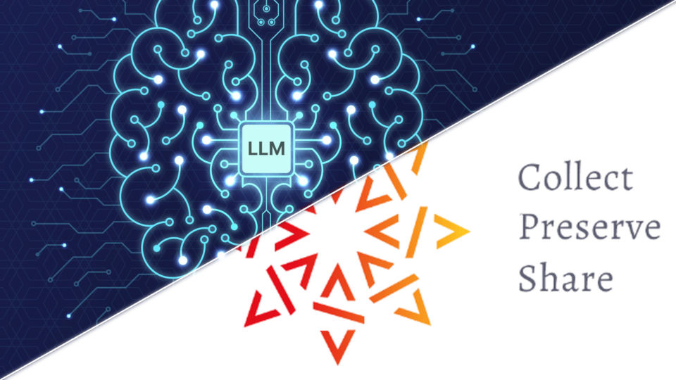

= Évaluation de code généré et patrimoine logiciel SoftwareHeritage - lundi 21 septembre 2026

.Rediffusion vidéo : https://www.youtube.com/watch?v=7y1TkWhUWF8 (merci Alex !)

== Actualités

Par **Michel Caradec** : link:2026.09.12-quoi_de_noeuf.pdf[2026.09.12-quoi_de_noeuf.pdf]

== Présentations
Présentations et personnes intervenantes :

* **Sergiu Mocanu** :
** "Établir si un programme marche avant de le lancer – est-ce possible ?"
** "SoftwareHeritage – La plus grande archive de code open source au monde !"

Les 2 diaporamas sont dans le même fichier : link:2026.09.12-Sergiu_Mocanu-Évaluation_code_généré-SoftwareHeritage.pdf[2026.09.12-Sergiu_Mocanu-Évaluation_code_généré-SoftwareHeritage.pdf]
