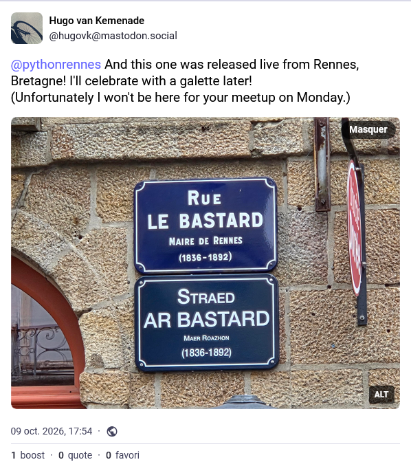

:revealjs_customtheme: assets/beige-stylesheet.css
:revealjs_progress: true
:revealjs_slideNumber: true
:source-highlighter: highlightjs
:icons: font
:toc:

= Python Rennes - lundi 12 octobre 2026

== VCRpy - Hacker avec et sans Claude

image::assets/2026.10.12-vcrpy_hacked.jpg[width="60%"]

[.medium-text]
--
- Accélérez vos tests avec VCRpy (**Pascal Le Merrer**)
- Au secours on s'est fait hacker pendant un downtime de Claude (**Nicolas Ledez**)
--

[.small-text]
--
Python Rennes - lundi 12 octobre 2026 - **Zenika** 🙏
--

== Prochainement dans http://rennes.tech

* mardi 13 octobre (Younup) : [Afup] Mobprogramming leekwar
* mardi 13 octobre (Le Poool) : [Yeeso] Conférence mixte de rentrée
* mercredi 14 octobre (Wijin) : [Software Crafters Rennes ] Plain Pattern Language
* jeudi 15 octobre (Le Poool) : [Mobile Rennes] Unicode for Mobile Developers
* jeudi 15 octobre (Néosoft) : [Rennes DevOps] Jenkins as-code sur GKE, puis cap sur Scaleway 🚀

[.columns]
== La communauté Python Rennes

[.column]
--
[.medium-text]
Communauté "services numériques" complétant les communautés datascience existantes.

[.medium-text]
764 membres

.Groupe meetup : https://www.meetup.com/fr-FR/python-rennes/
image::assets/python_rennes-communauté.png[communauté Python Rennes]
--

[.column]
--
[.medium-text]
Rejoignez https://pythonrennes.slack.com[pythonrennes.slack.com] (actualités, entraide, orga).

[.medium-text]
119 membres

.Invitation slack : https://join.slack.com/t/pythonrennes/shared_invite/zt-1yd4yioap-lBAngm3Q0jxAKLP6fYJR8w

--

[.column]
--
[.medium-text]
* Mastodon (83 membres) : https://social.breizhcamp.org/@pythonrennes[@pythonrennes@social.breizhcamp.org]
* BlueSky (63 membres) : https://bsky.app/profile/pythonrennes.bsky.social/[@pythonrennes.bsky.social]
* LinkedIn (56 membres) : https://www.linkedin.com/groups/13121746/[www.linkedin.com/groups/13121746]
--

== Quoi de n'œuf ?

image::assets/reptile-python-hatching-egg-820x459.jpg[credits: Heiko Kiera - Shutterstock - https://www.aboutanimals.com/reptile/, width=50%]

[.columns]
=== Écosystème Python - PSF

[.column]
--
Sortie de Python 3.15.0 🥳

[.small-text]
* imports différés
* builtins frozendict et sentinel
* profileur statistique Tachyon
* disponibilité ++ des frames d'exécution
* déballage de valeurs dans les compréhensions (`itertools.chain()` -> 🪦)
* IO en UTF-8 par défaut
* ABI stable de free-threading
* améliorations : TypedDict & TypeForm, JIT

[.small-text]
En détails : https://docs.python.org/3.15/whatsnew/
--

[.column]
--

--

=== Écosystème Python - du PEPs

* 2 PEP autour de None pour Python 3.16
** https://peps.python.org/pep-0823/[823] : None-aware access operators (`an_obj?.prop`, `a_dict?['key']`)
** https://peps.python.org/pep-0824/[824] : None-coalescing operators (`age = user.age ?? "unknown"`, `user ??= create_default_user()`)

=== Écosystème Python - les confs

PyConFR 2026 (29 oct-1er nov), Biarritz 🏖️, https://www.pycon.fr/2026/[www.pycon.fr/2026/]

* Nicolas Ledez (samedi 31 octobre - 10h30) : Au secours on s'est fait hacker pendant un downtime de Claude
* Luc Sorel-Giffo (dimanche 1er novembre - 11h30) : Construire une logique métier avec des opérateurs mathématiques : méthodes spéciales & métaclasses

📽️ Rediffusion des confs EuroPython 2026 : https://www.youtube.com/playlist?list=PLd3Y9yzyC5Uo[www.youtube.com/playlist?list=PLd3Y9yzyC5Uo]

=== Écosystème IT - les confs

Lettre ouverte pour la survie des événements techniques en France (8 septembre 2026 - soutenue par 70+ organisations) : https://lettreouverte.afup.org/

* crise silencieuse : baisse du sponsoring des confs IT & agile
* attention à la sédentarisation (IA agentique et formation en visio)
* confs = formations vivantes
* nourrir les vocations

[.medium-text]
-> re·venez aux confs, encouragez vos employeurs à les sponsoriser 🙏

=== Services et outils

https://pyref.dev[pyref.dev] : un service de raccourcis menant à la documentation officielle de la bibliothèque standard et d'une multitude de paquets

* https://pyref.dev/pathlib.Path[pyref.dev/pathlib.Path] -> https://docs.python.org/3/library/pathlib.html#pathlib.Path[docs.python.org/3/library/pathlib.html#pathlib.Path]
* https://pyref.dev/numpy.array[pyref.dev/numpy.array] -> https://numpy.org/doc/stable/reference/generated/numpy.array.html#numpy.array[numpy.org/doc/stable/reference/generated/numpy.array.html#numpy.array]

=== Cybersécurité

Article sur une tentative d'attaque via un hook git `post-checkout` téléchargeant et exécutant un binaire malicieux dans une base de code envoyée pour un test de collaboration : https://frankwiles.com/posts/i-got-targeted[frankwiles.com/posts/i-got-targeted]

En savoir plus sur les hooks git de pre-commit : 📽️ rediff' https://www.youtube.com/watch?v=qomozuegwuy&list=PLv7xGPH0RMUT1GSCGHJmqnswpk-nyz5aq&index=19[Hook'il est beau notre code !]

=== Code & architecture

* développer & intégrer un binaire rust dans Python
** configuration technique projet : https://rsbit.es/rust-in-python-pyo3-maturin/[rsbit.es/rust-in-python-pyo3-maturin]
** encapsulation de rust dans Python : https://belderbos.dev/blog/how-libraries-run-rust-inside-python/[belderbos.dev/blog/how-libraries-run-rust-inside-python]

=== Data

* conversion en Lua du scriptage Python pour Redis : https://github.com/IgnaceMaes/redis-lua-py[github.com/IgnaceMaes/redis-lua-py]

* polars 2.0 (perfs, SQL, Map dtype, etc.) : https://pola.rs/posts/release-polars-2/[pola.rs/posts/release-polars-2]

== D'autres nouvelles à partager ?

Django :

* sortie de la 6.2
* fin des releases semestrielles
* sorties annuelles qui seront toutes LTS
