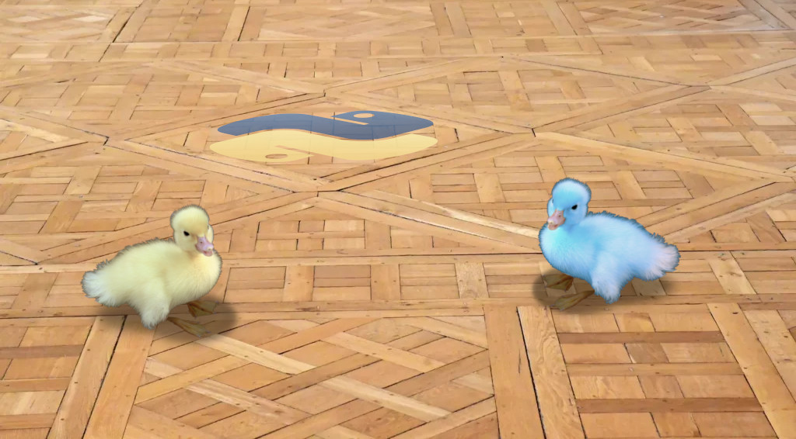
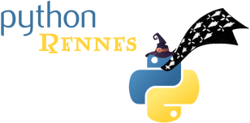
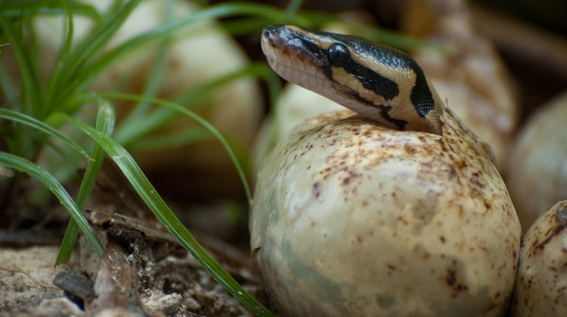

:revealjs_customtheme: assets/beige-stylesheet.css
:revealjs_progress: true
:revealjs_slideNumber: true
:source-highlighter: highlightjs
:icons: font
:toc:

= Python Rennes - lundi 16 novembre 2026

== DuckDB & Parquet - L’équipe gagnante pour l’analyse de données

[.medium-text]
--
- DuckDB & Parquet - L’équipe gagnante pour l’analyse de données (**Michel Caradec**)
--

[.small-text]
--
Python Rennes - lundi 16 novembre 2026 - **Néosoft** 🙏
--

== Prochainement dans http://rennes.tech

[.medium-text]
* jeudi 19 novembre (Liksi) : [Rennes DevOps] Jenkins as-code sur GKE & runners GitHub moins chers
* mercredi 25 novembre (Kanoma) : [Software Crafters Rennes] Faire MOINS, mais MIEUX : et si c’était ça la vraie productivité ?
* vendredi 4 décembre (La Mabilais) : [Software Crafters Rennes] Forum Ouvert Agile Rennes 2026
* lundi 18 janvier (Acensi) : [**Python Rennes**] rex IA agentique (Frédéric C., Alexandre C.)
* mardi 6 avril (Palais des congrès - St-Brieuc) : [Breizh Data Club] Breizh Data Day

[.columns]
=== La communauté Python Rennes

[.column]
--
[.medium-text]
Communauté "services numériques" complétant les communautés datascience existantes.

[.medium-text]
815 membres

.Groupe meetup : https://www.meetup.com/fr-FR/python-rennes/

--

[.column]
--
[.medium-text]
Rejoignez https://pythonrennes.slack.com[pythonrennes.slack.com] (actualités, entraide, orga).

[.medium-text]
122 membres

.Invitation slack : https://join.slack.com/t/pythonrennes/shared_invite/zt-1yd4yioap-lBAngm3Q0jxAKLP6fYJR8w

--

[.column]
--
[.medium-text]
* Mastodon (86 membres) : https://social.breizhcamp.org/@pythonrennes/[@pythonrennes@social.breizhcamp.org]
* BlueSky (64 membres) : https://bsky.app/profile/pythonrennes.bsky.social/[@pythonrennes.bsky.social]
* LinkedIn (58 membres) : https://www.linkedin.com/groups/13121746/[www.linkedin.com/groups/13121746]
--

== Quoi de n'œuf ?

=== Écosystème local

* playlist des conférences du BreizhCamp 2026 : https://www.youtube.com/playlist?list=PLEVsFwFmRJeM[www.youtube.com/playlist?list=PLEVsFwFmRJeM]
** https://www.youtube.com/watch?v=SSmwQAFXuOw&list=PLEVsFwFmRJeM&index=91[Tuner uv pour travailler avec Docker] (Florent Vuillemin)

=== Écosystème Python

* patchs concernant les certificats corruptibles eMudhra : python, pip, pipx, pipenv, pyenv, uv pdm, hatch, virtualenv, images Docker python, etc. : https://discuss.python.org/t/information-for-python-users-regarding-emudhra-emsign-ca-certificate-security-incident/109576[Information for Python users regarding eMudhra / emSign CA certificate security incident]

* supports des présentations de la PyConFR 2026 à Biarritz : https://discuss.afpy.org/t/les-supports-de-presentation-de-cette-superbe-pyconfr-2026/[discuss.afpy.org/t/les-supports-de-presentation-de-cette-superbe-pyconfr-2026] (notamment https://discuss.afpy.org/uploads/short-url/yiXTRdyNUbxeXtaRIDk2AmikBeq.pdf[le quiz joué en keynote])

=== Tutoriels

* migration vers Python 3.15 : https://mathspp.com/blog/migrating-to-python-315[mathspp.com/blog/migrating-to-python-315]

* implémentation du pattern annuler / refaire (ArjanCodes) : https://www.youtube.com/watch?v=ZXAt8AP3DnY[The memento pattern: saving state without breaking encapsulation]

=== Outils

* streamlit dans le navigateur : https://github.com/whitphx/stlite
** voir 📽️ https://youtu.be/yspHNEFjKfQ?list=PLv7xGPH0RMUT1GSCGHJmqnswpk-nyz5aq&t=859[Interfaces graphiques web en Python]
** voir 📽️ https://youtu.be/Dzjjwhx2Amk?si=MpU1aRPnD0DnTd5U&t=1127[Python loin de ton ordinateur]

* outil d'analyse d'AST pour rechercher du code mort ou non-atteignable : https://github.com/jendrikseipp/vulture[github.com/jendrikseipp/vulture]

=== D'autres nouvelles à partager ?
