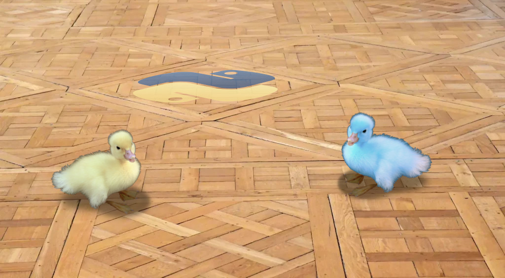

= Retours d'expérience de frameworks web et d'orchestration de workflows - lundi 27 avril 2026

.Rediffusion vidéo : https://www.youtube.com/watch?v=RJ6kRpE6i7U (merci Alex !)

== Actualités

Par **Luc Sorel-Giffo** : link:2026.11.16-quoi_de_noeuf.pdf[2026.11.16-quoi_de_noeuf.pdf] (source : link:2026.11.16-quoi_de_noeuf.adoc[2026.11.16-quoi_de_noeuf.adoc])

== Présentations

Présentations et personnes intervenantes :

* **Michel Caradec** : "DuckDB & Parquet - L’équipe gagnante pour l’analyse de données" (https://github.com/michelcaradec/meetup-duckdb-parquet[base de code], https://github.com/michelcaradec/meetup-duckdb-parquet/blob/main/prez/Meetup%20Python%20Rennes%20-%20DuckDB%20%26%20Parquet.pdf[diaporama])
